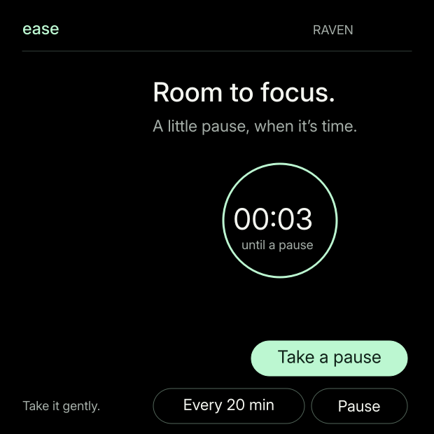
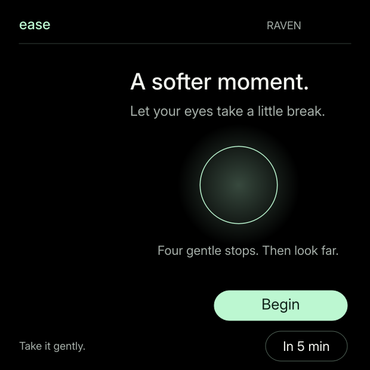
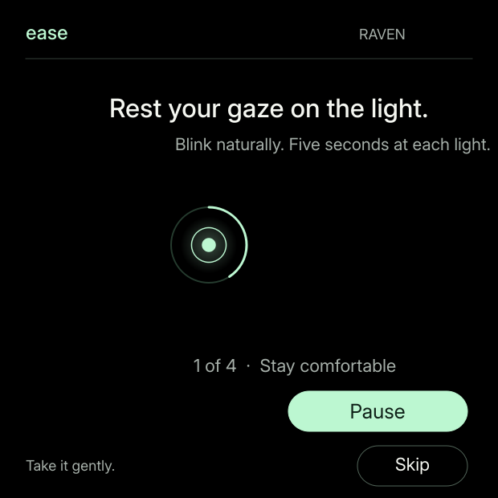
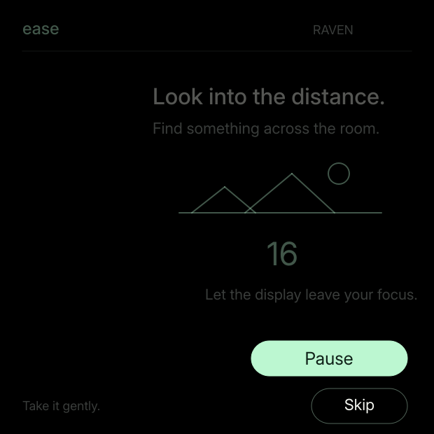

# Ease

**A quiet, gaze-led pause for Raven Prism.**

Ease stays at the edge of your workday, then invites you to soften your gaze. Follow four softly lit points at a comfortable pace, look at something distant in the real world for 20 seconds, then take a short, tracked eye-rest pause before returning to work.

[Watch the narrated demo](media/demo.mp4) · [Design and behavior](DESIGN.md) · [Submission notes](SUBMISSION.md)



## Try it

Requires Python 3.10 or newer and Git. Development and simulator checks used Python 3.12 with Raven Framework 1.0.7 and PySide6 6.9.3 on macOS. Install Raven's SDK separately from its official repository.

```bash
git clone https://github.com/srcJin/raven-ease.git
cd raven-ease
python3.12 -m venv .venv
source .venv/bin/activate
git clone https://github.com/RavenResonance/raven-framework.git raven-framework
python -m pip install -e ./raven-framework -r requirements.txt
./run.sh
```

Use an installed Python 3.10+ executable in place of `python3.12` if needed. On Windows, create the environment with `py -m venv .venv`, then use `.venv\Scripts\python.exe -m pip install -e ./raven-framework -r requirements.txt` and `.venv\Scripts\python.exe main.py`.

The app needs no account or API key for simulator use. The cursor acts as gaze. Hover inside a target's generous 55-pixel radius for 5 seconds of accumulated on-target gaze to continue. Mouse clicks and Raven dwell controls activate the buttons. Blink naturally. Missing gaze freezes progress, while looking at another location resets the current point.

- **Take a pause** starts immediately.
- **Every 20 min** cycles through 30, 10, and 20 minute reminders. The chosen interval persists locally.
- **Pause** freezes the work countdown or the current break. **Resume** continues it.
- A due reminder waits for **Begin**, or **In 5 min** postpones it.
- **Skip** leaves the exercise and starts a fresh work interval.
- During the eye-rest stage, look ahead briefly to establish tracking, then close comfortably. A gentle chime invites you to reopen. Ten seconds of recovered tracking loss completes this stage. On desktop, hold **C** to simulate closure and release it to simulate reopening.
- The distance stage runs for a full 20 seconds and requires no gaze confirmation. Look across the room, ideally at something about 20 feet away. Most of the display dims after the opening instruction.

Reminders run while this app is open. This prototype does not install a system-wide background reminder service.

## The experience

| Work quietly | Follow the light | Look into the distance |
| --- | --- | --- |
|  |  |  |

The mint light provides a clear target on Raven's additive display. Broad spacing, a black background, right-side controls, and short instructions leave room for the world around you. Target positions stay inside a modest central range. Take the exercise gently and skip any movement that feels uncomfortable.

The four-point gaze stage is an eye-movement interaction requested for this prototype. Each point requires five seconds of valid gaze, with natural blinks welcome. These exact timings are design choices and have not been clinically validated. See [Research and limitations](RESEARCH.md). The distant object is a real object beyond the display. Ease makes no claim to improve vision or treat an eye condition. The reminder and distance stage are informed by [AAO guidance for computer use](https://www.aao.org/eye-health/tips-prevention/computer-usage) and [AOA guidance on computer vision syndrome](https://www.aoa.org/healthy-eyes/eye-and-vision-conditions/computer-vision-syndrome).

## Evidence behind the routine

| Evidence | How it informs Ease |
| --- | --- |
| [AAO guidance](https://www.aao.org/eye-health/tips-prevention/computer-usage) encourages natural blinking and periodic distance breaks. | Blink-friendly target holds and a real-world distance stage. |
| A [29-person reminder study](https://pubmed.ncbi.nlm.nih.gov/35963776/) found symptom improvement but no tear-film or ocular-surface improvement. A [30-person reading study](https://pubmed.ncbi.nlm.nih.gov/36473088/) found no significant symptom difference among break schedules. | An adjustable reminder, with no claim that 20 minutes is the optimal interval. |
| A small [ten-person eye-closure study](https://pmc.ncbi.nlm.nih.gov/articles/PMC6499340/) reported subjective improvement, with design and sample-size limitations. | An optional, comfortable eye-rest stage, labeled as estimated from tracking. |
| The four five-second points and ten-second eye-rest target are prototype design choices. | This complete routine has not been clinically validated. |

Read the study limitations and additional blink research in [RESEARCH.md](RESEARCH.md).

## Eye-rest tracking

Gaze loss is only an estimate of closure. Head movement, an occluded sensor, and tracking faults can also cause loss. The interface says **Tracking lost · rest estimated**, and the completion screen labels the result **estimated rest**.

A candidate starts only after 0.5 seconds of valid tracking. It is accepted after tracking recovers for 0.25 seconds. Loss shorter than 0.5 seconds or longer than 15 seconds is rejected. Accepted intervals accumulate toward ten seconds. A sampling gap longer than 0.2 seconds clears an unfinished observation. The chime is provisional and prompts reopening; the interval is accepted only after recovery. Use this seated, take it comfortably, and skip any stage you prefer.

## Raven device integration

`EyeBreakApp` inherits `RavenApp` and launches through `RunApp.run`. It uses Raven `Container` and `Button`, plus a Qt-painted canvas. On a Raven device, `EyeControl.get_gaze_position()` provides display coordinates which are mapped into the canvas. Missing gaze pauses a target hold and does not advance it. Device samples must contain finite, nonnegative coordinates within the display. The desktop path maps the mouse directly to the canvas.

For an entitled device deployment, set the app credentials in your shell and run Raven's deployment command. Keep credentials out of source control.

```bash
export RAVEN_APP_ID="your-app-id"
export RAVEN_APP_KEY="your-app-key"
python main.py deploy
```

The current deliverable has been checked in the desktop simulator. Physical device gaze accuracy, entitlement behavior, and comfort require on-device evaluation.

## Validation and media

```bash
python -m unittest discover -s tests -v
python scripts/capture_demo.py
```

The eleven behavior and UI tests cover reminders, snooze, five-second gaze timing, natural-blink preservation, pause, the full distance stage, closure baseline and recovery, short-blink and long-fault rejection, coordinate validation, polling interruption, chime retry, closed-eye pause recovery, and skip.

The capture command opens the official Raven simulator in a desktop graphical session. `live_demo.py` supplies a deterministic gaze sequence while the simulator's own **Record** control records its stream. The script saves through the official recording dialog, measures the interval between recording start and demo start, and trims that preroll. Six screenshots are extracted from the recorded video. The resulting footage shows the official simulator view directly, with no added titles, captions, or decorative frame.

The 68-second sequence includes all four five-second gaze points, a full 20-second distance stage, and a ten-second eye-rest estimate. It begins three seconds before a reminder and holds the completion screen for the closing narration. This is a desktop simulator recording using scripted input. Keep the simulator window visible during capture. FFmpeg is required.

For manual recording or adjusting the setup delay:

```bash
python live_demo.py --delay 5 --record --preroll 3 --record-output /tmp/ease-official.mp4
```

The default recording contains three seconds of preroll followed by the 68-second demonstration. The window remains open after saving. Add `--exit-after-save` to close it automatically. Console markers `EASE_RECORD_T0` and `EASE_DEMO_START` provide the actual trim offset.

The final `media/demo.mp4` adds English Cartesia narration and a gentle chime to the official simulator video. Copy `.env.example` to `.env`, supply your API key, and run:

```bash
python scripts/narrate.py --env-file .env
```

To reuse already generated local narration segments, add `--reuse-audio`. `--video` and `--output` select alternate input and output paths. Narration is aligned to the recorded stages. The video stream is copied without adding or altering visual elements. Only the public narration transcript is sent to Cartesia. The application itself works offline. [Cartesia API reference](https://docs.cartesia.ai/api-reference/tts/bytes).

## License

Original application code and generated demo media are MIT licensed. Raven Framework is a separately installed proprietary dependency governed by its own license. No Raven Framework source code is included in this repository.
